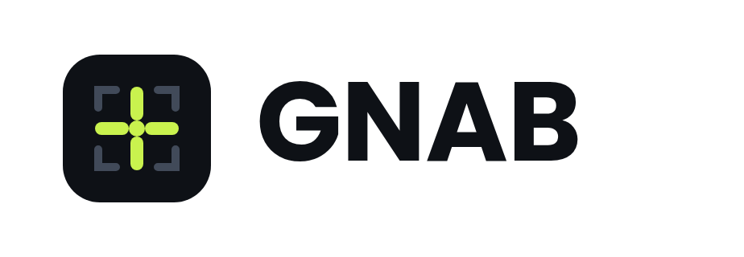
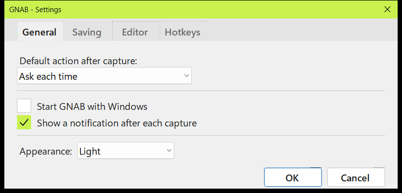
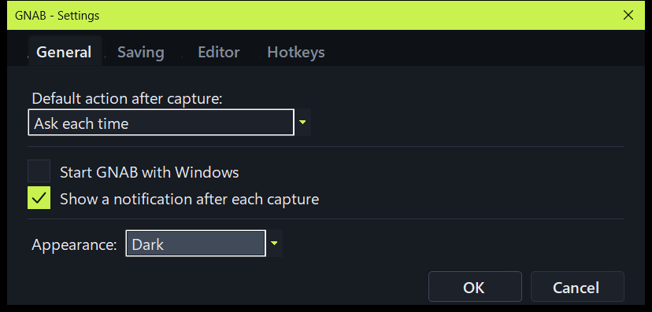

<p align="center">
  <picture>
    <source media="(prefers-color-scheme: dark)" srcset="Brandkit/png/gnab-lockup-dark.png">
    
  </picture>
</p>

<p align="center">
  A fast, lightweight screenshot tool for Windows that lives in your system tray.
</p>

<p align="center">
  
  
  
</p>

---

GNAB sits quietly in your system tray and captures the screen the moment you press a hotkey — full screen, a region you drag out, or the active window. Snap it, then save it, copy it, mark it up, or open it in your editor. No accounts, no telemetry, no background uploads.

## Features

- **Three capture modes** — full screen, drag-to-select region, or the active window
- **Global hotkeys** — capture from anywhere without switching windows; fully customizable
- **Pick what happens after capture** — save to a file, copy to the clipboard, both, open in an editor, open the built-in markup editor, or be asked each time
- **Built-in markup editor** — crop, draw with a pen or pencil, pick any color, undo, then save or copy
- **Copy text with OCR** — on the capture prompt, hit **Copy Text** to pull the words straight out of a screenshot onto your clipboard, using the OCR engine built into Windows (offline, no setup, no API keys)
- **Region selector** with a color-matched crosshair and dimmed overlay
- **Light / Dark / Match Windows** theming
- **Auto-save or prompt** — drop captures straight into a folder, or choose a location each time
- **Multiple formats** — PNG, JPG (with quality control), BMP, GIF, TIFF
- **Start with Windows** (optional)
- **Tiny footprint** — a native tray app, not a browser wrapped in a window

## Screenshots

<p align="center">
  
  
</p>

## Download & Install

1. Grab the latest **`Gnab.exe`** from the [Releases page](../../releases/latest).
2. Double-click to run. It's a single self-contained file — no .NET runtime or installer required.
3. GNAB starts in your system tray. Double-click the tray icon to capture a region, or right-click for all options and **Settings**.

> [!NOTE]
> **"Windows protected your PC" warning.** GNAB isn't code-signed (signing certificates are expensive for a free tool), so Windows SmartScreen may warn you the first time you run it. Click **More info → Run anyway**. The full source is in this repo if you'd rather build it yourself.

## Default Hotkeys

| Action | Shortcut |
| --- | --- |
| Capture full screen | `Ctrl + Shift + F` |
| Capture region | `Ctrl + Shift + R` |
| Capture active window | `Ctrl + Shift + W` |

All three can be changed under **Settings → Hotkeys** — click **Capture**, then press the combination you want.

## Build from Source

Requires the [.NET 8 SDK](https://dotnet.microsoft.com/download/dotnet/8.0).

```powershell
git clone https://github.com/DriverlaneDev/GNAB.git
cd GNAB
dotnet build Gnab/Gnab.csproj -c Release
```

To produce the self-contained single-file executable (what ships on the Releases page):

```powershell
./publish.ps1
# output: Gnab/bin/Publish/Gnab.exe
```

## Tech

Built with C# and .NET 8 WinForms. Global hotkeys, native dark title bars, and the tray integration use direct Win32 interop; no third-party UI frameworks.

## License

Released under the [PolyForm Noncommercial License 1.0.0](LICENSE.md) — free to use, modify, and share for any noncommercial purpose. You may not sell it or use it commercially.
